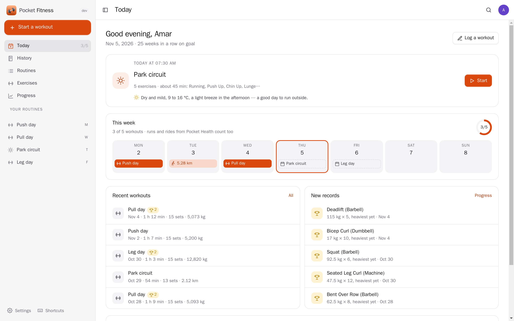
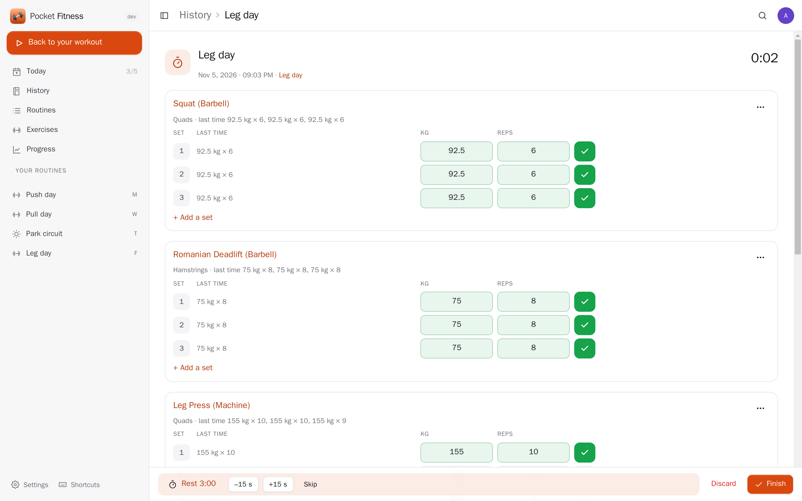
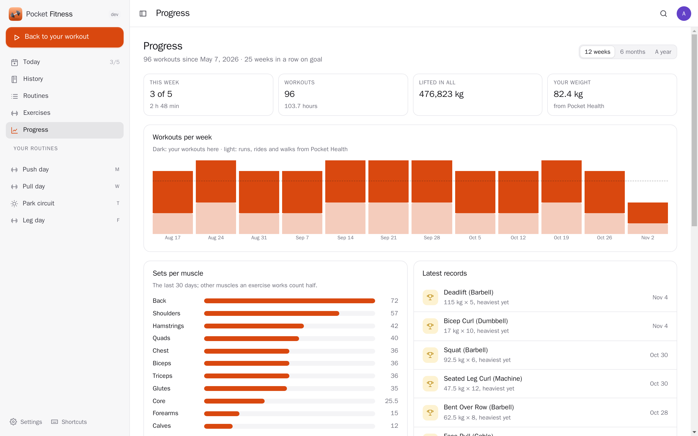
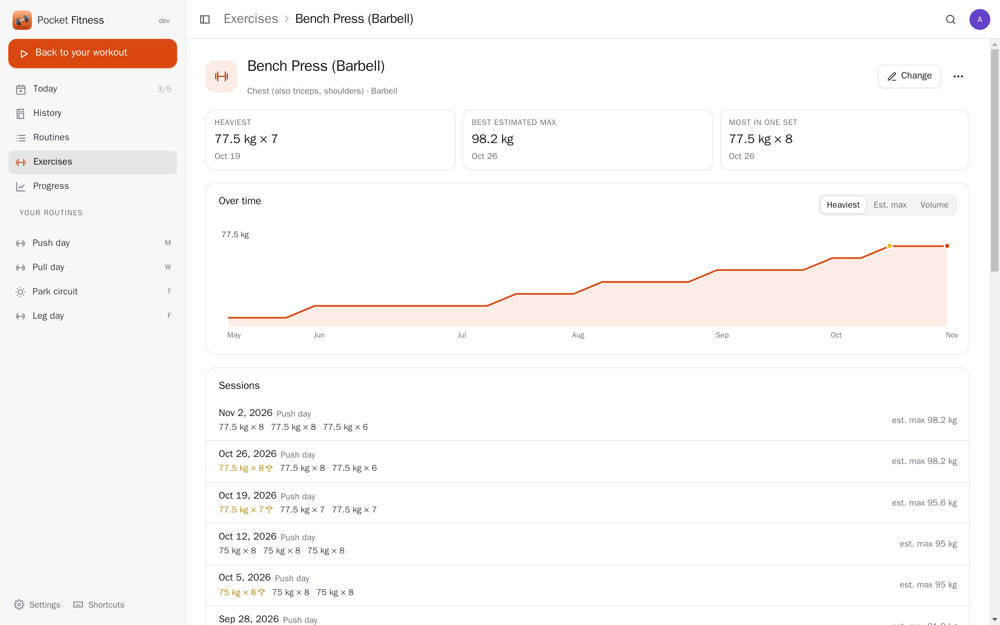
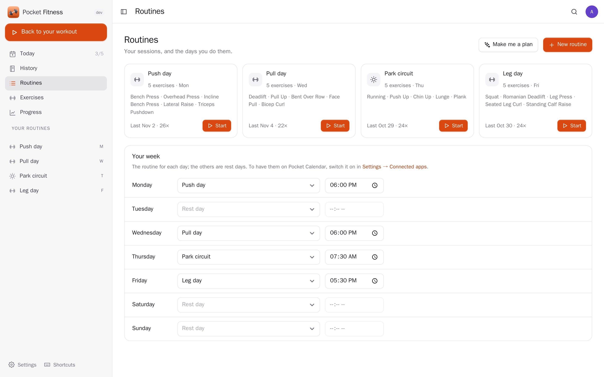
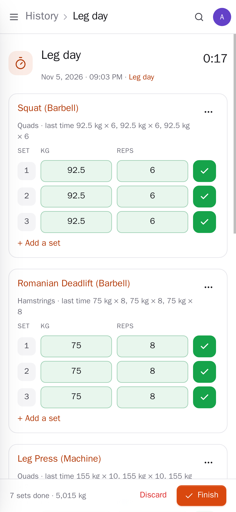
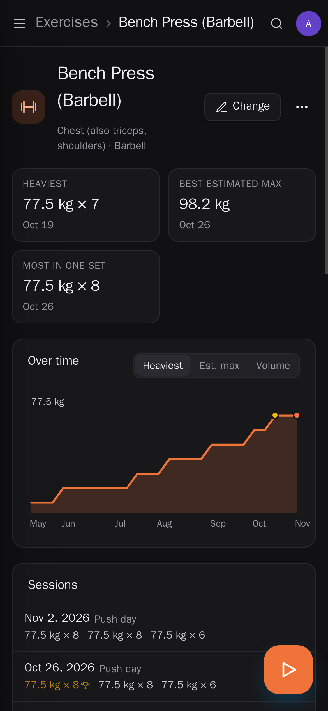

<p align="center"></p>
<h1 align="center">Pocket Fitness</h1>
<p align="center">Your training log: workouts with sets, reps and weights, routines and a weekly plan, a rest timer, personal records and progress per exercise and muscle. It counts the runs from your watch toward your week, records each workout in Pocket Health, ticks your habit, puts planned sessions on your calendar, and drafts routines and reviews your training with Pocket AI. Imports from Strong and Hevy.<br>One Go binary, one SQLite file, one volume. Part of the Pocket apps; works on its own too.</p>
<p align="center">
  <a href="https://github.com/abjelosevic88/pocket-homelab-fitness/actions"></a>
  <a href="https://github.com/abjelosevic88/pocket-homelab-fitness/pkgs/container/pocket-homelab-fitness"></a>
  <a href="LICENSE"></a>
</p>

---

<p align="center"></p>

<table>
  <tr>
    <td width="50%"></td>
    <td width="50%"></td>
  </tr>
  <tr>
    <td align="center"><sub>In the gym: last time's numbers next to each set, a tick per set, and the rest timer.</sub></td>
    <td align="center"><sub>Progress: workouts per week against your goal (runs from Pocket Health too), sets per muscle, records.</sub></td>
  </tr>
  <tr>
    <td width="50%"></td>
    <td width="50%"></td>
  </tr>
  <tr>
    <td align="center"><sub>Every exercise: your records, the heaviest set, estimated max or volume over time.</sub></td>
    <td align="center"><sub>Routines and your week: which session on which day, at what time.</sub></td>
  </tr>
  <tr>
    <td width="50%"></td>
    <td width="50%"></td>
  </tr>
  <tr>
    <td align="center"><sub>Made for the phone in the gym: big fields, one tap per set.</sub></td>
    <td align="center"><sub>Light and dark follow the system.</sub></td>
  </tr>
</table>

## What it does

- **Workouts as you do them**: start from a routine (sets filled with last time's numbers) or empty, tick each set, swap or add exercises, warm-up, drop and failure sets, a rest timer with a buzz, the plates for each side of the bar. Saved as you go; finish when you are done.
- **Routines and your week**: sessions with sets, rep ranges, weights and rest to aim for; which one on which day and when. "Make me a plan" drafts routines with Pocket AI from your goal, days, time and equipment.
- **Records**: heaviest set, best estimated one-rep max, most in one set, most reps, longest, furthest — marked on the set that beat everything before it.
- **Progress**: workouts per week against your goal, sets per muscle, every exercise over time, your weight, and your training in plain words from Pocket AI.
- **Log it later**: type a past workout set by set, or write it in a sentence ("bench 3×8 at 80, then pull-ups and a 5 km run") and check what Pocket AI understood.
- **Built-in exercises** named like Strong and Hevy, plus your own; **import** your Strong or Hevy history (CSV) — importing twice adds nothing.
- **Messages**: the morning of a planned session, and on Mondays how last week went (Apprise, ntfy or a webhook).
- **Everyone their own**: each person has their own exercises, routines, workouts, settings and connections; admins see no one else's.

## Run it

```sh
docker run -d --name pocket-fitness -p 8080:8080 -v ./data:/data \
  -e BASE_URL=https://fitness.example.com -e SECURE_COOKIES=true \
  ghcr.io/abjelosevic88/pocket-homelab-fitness:latest
```

or `docker compose up -d` with [docker-compose.yml](docker-compose.yml). Open it, create the first account and start a workout. All options: [docs/configuration.md](docs/configuration.md). API: [docs/api.md](docs/api.md).

## With Pocket Core

Set `CORE_URL` and `CORE_REGISTRATION_KEY` and Fitness joins the box: people sign in with Pocket Core, and through app links each person's Fitness reaches their own Pocket apps with nothing to paste (or directly with a URL and token, per person).

| App | What Fitness does there | Scopes |
|---|---|---|
| Pocket Health | records each finished workout; counts your runs, rides and walks toward the week; your weight | `health:read`, `health:write` |
| Pocket Habits | ticks the habit you choose on the days you train | `habits:read`, `entries:write` |
| Pocket Calendar | puts the planned sessions of the next two weeks on your calendar, and moves or removes them when the plan changes | `calendar:read`, `calendar:write` |
| Pocket Weather | the day's weather for an outdoor session | `weather:read` |
| Pocket Music | a playlist to train to, one tap from the workout | `playlists:write` |
| Pocket AI | your training in plain words, routines from a goal, a workout from a sentence; the Ask button on every page | inference |

Other apps can read and log your training (`fitness:read`: each day's workouts in Pocket Day's journal, the Fitness card in Pocket AI's briefing, the `pocket_fitness_*` tools Pocket AI uses to answer "how is my bench going?"; `fitness:write`: "log 3×8 bench at 80" from Pocket AI). Events: `fitness.workout_done`, `fitness.record`, `fitness.goal_met`, `fitness.plan_today`.

## Develop

```sh
make dev     # API on :8080 with demo data (six months of workouts, made-up linked apps) + Vite on :5173
make test    # go vet, go test, tsc
make         # web + binary
```

MIT licensed.
